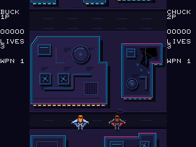
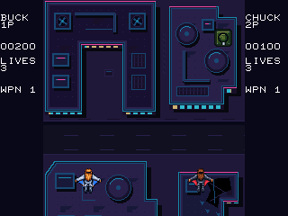

# Global Saturn reset and Level 2 wingsuit colors

The feature starts from PCM8 Pass 2 commit `9d7b1018af5757f01b5b48e8d20e11a10789e0c8`.

Hold **START + A + B + C** on either controller to request a Saturn system reset. The VBlank callback latches the complete chord after Jo polls the controllers. The main callback clears pending inputs, waits for queued DMA, then requests the SMPC system reset through SGL's `slSystemReset()`. The normal boot path reinitializes the game. A controller must leave the chord before it can trigger another reset, including after boot.

Level 2's existing sound handoff temporarily stops peripheral polling. Hold the chord until polling resumes to reset during that window. A tap wholly within the polling gap can be missed. Reset service also requires the main thread to return from the current SDK call. A hard lock inside an SDK call or a diagnostic state with polling permanently unavailable requires the console reset or power button.

## Emulator checks

Yabause 0.9.15 received one SYSRES command in each of the gallery, title, Level 1, stage-clear transition, Level 2 and controlled E108 tests. The E108 test used a separate disc image whose Level 2 music-map directory entry was renamed to force the existing missing-file diagnostic. Both physical controller slots were exercised. A three-button combination produced zero reset commands. Two chords separated by a release produced two commands. A chord held from power-on produced zero commands.

During the Level 2 tone upload, a sustained chord produced one request after polling resumed. A short tap wholly inside the polling gap produced zero. The normal disc reached both stages, including two-player Level 2 gameplay, without displaying E108 or E008 during the smoke runs.

Yabause does not implement SYSRES. A separate fixture substituted Yabause's full-machine restart after observing the command to exercise repeated boots with the chord still held. Actual Saturn SYSRES completion and post-SYSRES sound and gameplay restoration require validation on hardware or an emulator that implements the command.

## Level 2 screenshots

Buck's cobalt membranes and Chuck's red membranes use RGB555 in all three poses. The six frames remain 32×32. Only membrane color words changed. The 28-texture Level 2 bank remains 33,792 bytes.

